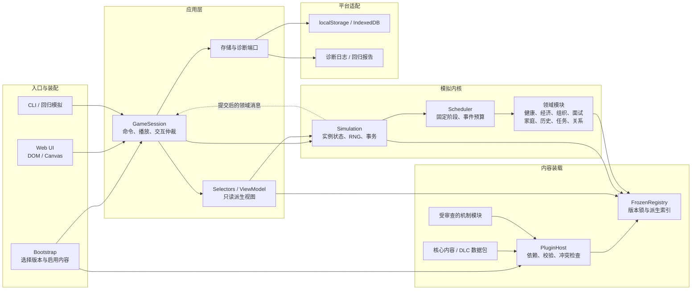

# 工程化架构决策：TypeScript、领域模块与内容插件

日期：2026-10-20。审查基线：`89055db4823d9a5757aa3bc936fc7ab811e7bab7`，包含重新拉取的架构说明、雇佣模型修正和矿石病重构提案。

**本次确立的目标：采用 TypeScript + ES Modules + Vite 的模块化单体，保留原生 DOM/Canvas 界面；以独立模拟实例、明确的领域接口、开局冻结的内容注册表实现扩展。** 内容 DLC 优先声明式注册；改变规则的机制模块通过受控接口接入。当前游戏仍是普通 JavaScript 脚本，本文件是后续实施基线，不代表已经完成迁移。

阅读顺序：本文件确定边界和决策；[实施路线](工程化实施路线-2026-10-20.md)确定交付次序；[系统架构与工程说明](系统架构与工程说明.md)描述现有实现；[DLC 计划](组织DLC更新计划.md)和[矿石病提案](矿石病系统重构提案-2026-10-20.md)提供需求。

## 1. 审查结论

### 已经值得保留的基础

- `job` 与 `affiliation` 已分开，组织具有入职、晋升、历史转任、离职和人物往来的完整路径。
- 面试有数据格式、原子注册校验、独立试卷快照，以及开始、作答、录用时的资格复核。应复用其语义。
- 事件执行集中在 `fire()`，有年份、条件、冷却和次数检查；快转也经过正常事件路径。
- 新增的雇佣模型把稳定编制、合同、罗德岛和无薪组织分开，退休金锁定月额，年度工资快照使用实际结算值。
- 无头模拟和专项检查已覆盖大量玩法边界。工程化应围绕这些行为建立契约，而非先替换所有算法。

### Evidence → Finding → Path

下表的风险针对后续扩展；没有将所有设计限制认定为当前玩家必然遇到的故障。

| 编号 | 源码证据 Evidence | 发现 Finding | 改进路径 Path |
| --- | --- | --- | --- |
| E01 | `index.html:311–337` 顺序加载 27 个脚本；各文件写 `window.TL` | 依赖由加载顺序和可选函数判断维持；替换同名函数缺少统一约束 | 单一组合入口、ESM 导入、禁止跨领域私有导入 |
| E02 | `state.js` 同时创建身份、随机初始化、播放状态和收入；`year.js` 同时做时钟、经济、家庭、死亡和报告 | 文件夹分层尚未形成状态所有权；添加一个系统会触及多个“大文件” | 拆分领域与应用控制，保留一个权威 `GameState` |
| E03 | `data/events.js` 包含 `scheduleEvents()`、职业抽取和大量 `run(S)`；`data/timeline.js` 同时包含执行逻辑 | “数据文件”携带代码和状态副作用，JSON 题包能力不能直接推广为完整 DLC | 内容定义、规则处理器、调度器分离 |
| E04 | `rng.js` 的 `_rnd` 和闭包内部状态全局共享；`TL.S` 为全局当前人生 | 同一运行环境中的多个人生会争用随机源；仅保存种子不能恢复中途随机位置 | `createSimulation()` 注入实例 RNG，支持导出/恢复随机状态 |
| E05 | `decision.js` 在 `pending._def/_opts` 保存含函数的对象；`interview.js:229` 包装单个 `afterDecision` | 完整状态不能直接 JSON 序列化；新任务链容易与面试争抢后续抉择 | 可序列化 interaction、统一续接仲裁、带类型的领域消息 |
| E06 | `year.js` 的 `fire()` 在 `run(S)` 后才记录次数，异常仅记录 console | 事件先改状态再报错会留下半次效果；插件数量增加会放大诊断难度 | 事务草稿、一次提交、结构化错误和 RNG 回滚 |
| E07 | `timeline.js` 加载时构造 `BY_YEAR`、`TL_BY_ID` 和缓存；`organizations.js` 构造 `ORGANIZATION_LIST` | 运行时直接追加原数组/对象会产生索引不一致 | 全量校验后统一建立索引；每局注册表冻结 |
| E08 | `events.js` 的多个 `when` 调用 `TL.chance()`；抽取和执行都会调用条件 | 条件查询有随机副作用；仅增加预览/诊断查询也可能改变人生 | 新格式的条件为纯查询，概率只在调度或效果执行的明确位置抽取 |
| E09 | `EMPLOYMENT_MODELS.protectedEvents` 按事件 ID 保护；`computeIncome → syncOrganization → leaveOrganization → computeIncome` 存在回调链 | 查询收入可能导致离职；未来新事件若直接改职业可绕过政策 | 领域命令执行资格检查，收入改为纯计算，退休为显式事务 |
| E10 | `lifetable.js` 硬编码 `crystal >= 100`；UI、年度快照与报告直接读取 `crystal` | 换双指标时仅替换 `oripathy.js` 会遗漏死亡和展示耦合 | 病程接口、风险贡献接口、独立视图与版本化迁移 |
| E11 | `main.js` 的 `saveLife()` 只写死亡摘要；`.github/workflows/pages.yml` 只复制并部署静态文件 | 尚无中途存档、格式迁移与发布前验证关卡 | 存储端口和版本信封；CI 必须先通过检查再部署 |
| E12 | `tools/sim-context.mjs` 从 HTML 提取脚本；`tools/headless.mjs` 另维护文件列表，重复加载 region/cohort | 测试装配与浏览器装配容易漂移，ESM 迁移后旧正则不再适用 | 共用组合函数；旧 VM 加载器只留作迁移对照 |

`fire()` 半次效果及年表索引问题已在内存探针中确认：注入“余额 +77 后抛错”的事件，余额仍增加 77、次数仍为 0；向 `TIMELINE` 追加某年事件后，源数组包含它而 `tlAt(year)` 不包含。探针仅修改临时 VM，未改游戏源码。

现有架构图对整体调用链描述基本准确，但它是**运行调用图**，不能作为单向模块依赖约束。`year → events → engine` 等交叉访问仍存在；矿石病、随机状态和持久化边界也需要在目标图中显式表达。

## 2. TypeScript 的决策

### 采用，但先改变边界再逐步补齐类型

| 方案 | 本项目适合程度 | 决策 |
| --- | --- | --- |
| 维持全局 JS，仅增加校验 | 短期简单，跨系统重构仍主要依赖人工追踪 | 只作为迁移起点 |
| JS + JSDoc/checkJs | 能逐文件接入检查，但大型全局 `TL` 的类型维护成本仍高 | 用于过渡及暂未迁移的边界 |
| TS + ESM + Vite，保留原生 UI | 可约束领域接口、交互状态、内容引用与构建入口 | 目标方案 |
| 同时换 React/Vue、ECS、全量事件溯源或微服务 | 不能直接解决当前最主要的规则耦合，扩大验证范围 | 当前不引入 |

TS 的直接价值是让“待面试/已录用”“在职/退休”“感染/未感染”等状态使用判别联合；让领域只接受自己支持的命令；让内容作者得到字段补全。新源码使用 `strict`、`noUncheckedIndexedAccess`，稳定契约启用 `exactOptionalPropertyTypes`；遗留桥接允许局部 `unknown` 和显式校验，不用一个 `TL: any` 宣称完成迁移。

外部 JSON、旧存储和 DLC 仍必须运行时校验。组织 ID、时间窗和依赖关系不能只依赖 TS：新 DLC 的 ID 不可能全部预先写死在核心联合类型中。已知核心 ID 可由数据推导，外部 ID 经注册器验证后转为带品牌的类型。

迁移可以让 JS/TS 共存，逐模块启用检查；TypeScript 官方提供 `allowJs` 和 JS 渐进迁移路径。[TypeScript 迁移文档](https://www.typescriptlang.org/docs/handbook/migrating-from-javascript.html)、[checkJs](https://www.typescriptlang.org/tsconfig/checkJs.html)。

Vite 负责开发服务和生产打包，类型检查单独运行 `tsc --noEmit`，不能把打包成功视为类型检查通过。[Vite TypeScript 说明](https://vite.dev/guide/features#typescript)。

### 保留静态部署与离线发行能力

- 主发行使用构建后的静态资源，继续部署 GitHub Pages；按实际仓库路径配置 `base`，验证 `/terra-life/` 子路径。[Vite 构建说明](https://vite.dev/guide/build)。
- 原版的双击 `index.html` 是已有能力。迁移期间保留旧入口；如发行继续承诺双击运行，需另产出单入口 IIFE 离线包，内嵌注册内容、使用相对资源路径，不依赖 ESM 动态加载或 `fetch()` 读本地 JSON。
- HTTP 静态发行与双击离线发行分别验收。单独设置 `base: './'` 不等于已经解决所有 `file://` 模块限制。
- 当前不增加服务器、账号、数据库服务或远程插件商店；完整本地续玩可后续使用 IndexedDB 适配器。

## 3. 目标系统架构

图中实线表示调用或受控数据交付，虚线表示提交后的通知。`Bootstrap` 是唯一认识具体模块与适配器的装配点。可编辑图源见 [target-architecture.mmd](architecture/target-architecture.mmd)。



### 依赖规则

1. `contracts` 只放类型、JSON 值定义、稳定 ID 和错误协议，不读取 DOM、存储、全局变量。
2. `kernel` 依赖契约和注入的处理器；不能导入具体罗德岛数据、UI、localStorage 或任何 DLC。
3. `domains/*` 依赖契约及公开能力端口；同级模块不导入对方内部实现。跨领域工作通过应用/运行时编排调用明确端口。
4. `content` 只提供定义和受支持处理器的参数，不依赖 UI 或主动创建模拟实例。
5. `application` 编排内核、只读视图和存储；`ui` 只能发送命令和读取 ViewModel，不持有可写状态。
6. `platform` 实现存储、时钟、诊断端口；`bootstrap` 注入实现。编译和 lint/import 检查共同守住边界。

先用单仓库、单 npm 包和目录边界；只有 SDK 真正需要独立发布或出现第二个应用时，再考虑 workspace 多包拆分。

```text
src/
  bootstrap/                 浏览器与无头模式共用的装配
  contracts/                 状态、命令、消息、内容与插件契约
  kernel/                    simulation、rng、queue、transaction、scheduler
  domains/
    identity/                出身、种族、地区资格
    health/                  暴露、病程、治疗、检测与风险贡献
    mortality/               生存概率聚合、死亡判定和归因
    economy/                 收入、年度账本、补给和退休权益
    organizations/           归属、路线、晋升、申请资格
    interviews/              抽题、试卷、答案和评分
    family/                  家庭与教育等既有生命周期
    history/                 世界节点、地区影响、个人影响
    quests/                  按 DLC 需求实现任务状态机
    relationships/           按 DLC 需求实现人物联系
  content/
    core/                    核心数据，使用同一注册契约
    dlc/                     每包 manifest、数据、来源与迁移说明
  plugins/                   注册、依赖、冲突、版本与贡献类型
  application/               session、commands、interaction、view-models
  platform/                  浏览器存储、时钟、错误与日志
  ui/                        现有 DOM/Canvas 界面分模块迁移
  legacy/                    有期限的 TL 桥接和旧规则适配
tests/                       契约、不变量、场景、回放、浏览器
tools/                       校验、批量模拟、数据生成与发行
schemas/                     内容/存储格式的校验源
```

这是目标目录，不要求先创建空目录。第一次拆分优先覆盖实际迁移代码。

## 4. 状态、时钟和事件执行协议

### 状态所有权

每个 `Simulation` 持有自己的 `GameState`、RNG 和事件队列；只共享不可变内容。UI 播放倍速、弹窗开闭、动画进度属于 `PlaybackState`，不进入领域状态。模拟年内时间、重心投入、待处理交互属于可恢复状态。

| 状态分区 | 唯一写入责任 | 对外提供 |
| --- | --- | --- |
| identity / world | 身份与历史领域 | 地区、年龄、特质、世界状态查询 |
| health | 健康领域 | 临床、检测、工作能力、可见特征与死亡风险贡献 |
| career / employment | 组织与职业转换服务 | 在职资格、合同、等级、保护政策 |
| economy | 经济领域 | 月额报价、年度账本、补给、养老金权益 |
| family / education | 对应生命周期模块 | 家庭与学历视图 |
| interaction / quests | 交互仲裁与任务模块 | 稳定会话 ID、下一步和结果 |
| relationships | 关系模块 | 联系资格、冷却与互动历史 |
| history / statistics | 运行时记录器 | 结构化记录及报告投影 |

跨领域变化由一个事务协调。例如退休：检查年龄和任职 → 锁定退休政策及最终月额 → 生成权益 → 结束组织履历 → 切换职业 → 更新收入视图，一次提交。不得在渲染或收入查询中隐式执行退休。

### 三种概念分开命名

- `Command`：玩家/应用的请求，如选择重心、提交答案、申请转任；包含会话/决策标识及预期状态修订号，拒绝过期和重复提交。
- `ScheduledEvent`：将来执行的内容引用，保存内容 ID、载荷、年内位置、来源包和稳定序号，不保存函数。
- `DomainEvent`：已经成功发生的事实，如任职结束、答案提交、人生结束；提交后发给 UI、日志或后续流程。

领域消息用于通知与受控续接，不让所有模块订阅一个万能总线并任意改状态。必须串行完成的收入、病程、死亡等步骤仍使用显式阶段调用。

### 固定年度顺序

迁移第一阶段完整保留当前顺序和随机消耗：重心 → 爱好/教育 → 收入/年度收支 → 属性回归/知识 → 矿石病 → 组织服务/晋升 → 本年快照 → 家庭 → 年度死亡 → 进入下一年/退休 → 历史影响 → 新年排程。

目标阶段在代码中使用稳定 `PhaseId` 表达，每个阶段只允许已声明的能力处理器接入；所有顺序进入规则版本。不能用 `onYear` 钩子的任意注册顺序决定工资是在晋升前还是晋升后发放。

同一事件时刻以 `(year, at, priority, sequence)` 排序。优先级枚举由内核定义；内容包不能自行无限提高优先级。历史紧急去留优先于普通任务；面试会话按现有语义连续推进，外部交互由仲裁器排队，并在展示/兑现时再次验证资格。

### 效果事务与失败策略

目标事件处理器读取只读状态和明确的 RNG 能力，产生有限的 `Effect[]`，例如属性变化、账目、开始申请、安排事件、叙事记录。禁止任意 JSON 路径写入；`startApplication` 不能替代“通过面试后入职”的受保护转换。

执行流程：

1. 校验命令/事件来源、资格、冷却和次数；新格式的资格条件不消耗随机数。
2. 复制或建立可回滚草稿，记录 RNG、队列和日志游标。
3. 计算效果并逐项执行领域政策，验证最终状态不变量。
4. 一次提交状态、RNG、队列、次数和记录，再通知 UI。
5. 失败时丢弃全部草稿，恢复随机位置，记录包/事件/版本/模拟时刻，暂停在可诊断状态。不得静默继续或永久自动重试同一坏事件。

初期状态规模可先用整份可序列化草稿验证正确性，再按测量结果优化；不为每一帧深拷贝。旧 `run(S)` 在迁移完成前走显式 legacy 适配，不宣称它已满足新插件的事务与能力约束。

`when` 去随机化会改变旧规则概率和随机序列。应独立升级 `rulesetVersion`，进行分布校准，不能混入“只改模块路径”的等价重构。

## 5. 插件与 DLC 契约

### 区分内容包与机制模块

| 扩展 | 可以贡献 | 不允许依赖的行为 |
| --- | --- | --- |
| 内容 DLC | 组织/路线、岗位、事件、历史节点、题库、任务定义、人物出场、资料来源 | 任意执行脚本、修改核心状态、覆盖其他包对象 |
| 机制模块 | 已审查并随构建发布的 TS 处理器、状态 schema、迁移器、固定阶段能力 | 任意远程加载代码、改全局 RNG、直接操作 DOM/存储 |
| UI 扩展 | 由应用提供的明确展示槽与 ViewModel | 模拟年度结算或控制健康/职业状态 |

首版只需要内容 DLC 和仓库内机制模块；复杂 UI 插件可以等实际需求出现。TypeScript 不是沙箱，同进程 JS 插件也不具备安全隔离；不开放上传任意代码的功能。

内容条件先提供小型有限结构，例如国家/年份/资格过滤、all/any/not；特殊条件引用已注册的 typed predicate。效果同样使用有限白名单。不要为了能表达所有 JavaScript 而创造一套完整脚本语言。

### 外层清单的目标字段

以下为完整 DLC 新协议的设计，**不是当前 `registerInterviewPack()` 已支持的格式**：

| 字段 | 约束 |
| --- | --- |
| `manifestVersion` | 清单结构版本，首版为 1 |
| `id` | 稳定包 ID，沿用 `dlc_<主题>` |
| `version` | 完整包 SemVer 版本；与既有题包的正整数版本分开 |
| `requiresCore` / `requiresApi` | 所需规则/内容能力版本范围，拒绝不满足的版本 |
| `dependsOn` / `conflictsWith` | 显式依赖和冲突；禁止循环，不在运行中联网自动选版本 |
| `provides` / `requiresCapabilities` | 类型化能力 ID 和接口版本 |
| `adds` / `extends` | 新增项及明确扩展项，拒绝默认覆盖 |
| `sources` | 资料入口、核查日期、设定事实/项目规则/不确定性 |
| `migrations` | 数据格式或 ID 变化的迁移声明；数据包仅允许受限映射 |
| `content` | 构建清单中的数据资源引用；不执行清单任意 `files` 脚本 |

既有面试包继续使用 `schemaVersion: 1`、整数 `version` 和原 ID；外层清单通过适配器引用它。不要为了统一新格式破坏 106 道题和已有工具。

所有新内容 ID 使用包前缀，旧 ID 原样保留。registry 中用 `(kind, id)` 定位实体，记录 `ownerPackage`；新包不能冒充核心前缀。组织、岗位、人物、问题引用跨包时必须声明依赖。

### 加载生命周期

`discover → resolve → validate → stage → buildIndexes → freeze → createSimulation`

1. 从构建产物或用户选择的受限 JSON 数据取得候选包。
2. 检查版本、依赖和冲突；拓扑排序，同层按稳定包 ID 排序。实际启用的精确版本与内容哈希写入 `ContentLock`。
3. 先校验 schema，再校验所有跨文件引用、时间窗、组织资格、任务终点、题库维度和抽题可达性。
4. 在暂存注册表应用 `adds/extends`。出现错误整组启用操作失败，原注册表保持不变；不得只装半个 DLC。
5. 一次构建组织列表、年表索引、事件分类和能力映射；冻结后给新局使用。缓存属于该 registry，不能跨不同内容版本复用。
6. 玩家可在新局配置中启用/禁用 DLC；已开始的人生锁定内容组合。取消必需依赖时提示连带关系，不自动忽略冲突。

`extends` 只支持明确操作，如追加题目、路线、任务、人物窗口；同一目标字段被多个包修改时拒绝冲突，除非它们显式依赖且使用带前置版本/值检查的补丁。禁止“最后加载者获胜”。

核心内容也通过相同注册机制装载，但基础能力不能随意禁用。加载完内容不代表新组织可玩：必须同时拥有资格、招募、任务、晋升、退出、人物与题库等所需贡献。

### DLC 计划的实际落点

- DLC 01 深化黑钢/雷神：扩展现有组织 ID 和雇佣政策引用；用它验证注册器、任务链和退出路径，不重新创建两家公司。
- DLC 02 事务所、DLC 03 商路：需要任务实例、阶段条件、期限、失败/取消出口；不用一串未约束的 `flags` 拼接。
- DLC 04 红松：从“感染骑士路线”到独立组织必须检查既有身份、年份、地点与玩家选择；数据迁移不能把所有感染骑士批量改为红松成员。
- DLC 05 深海猎人：特殊身份由 identity 能力先决条件约束，面试只决定合作/接纳，不能创建身体改造事实；保留“协作”路线与“正式成员”的区别。
- 人物关系使用独立稳定 `CharacterId`；任职组织与人物在场分别建模，允许同一人在不同组织/时期出现。不要把离任当死亡或每个组织复制一份同名人物。
- 任务实例仅保存定义 ID、节点 ID、变量、截止时间及状态；节点迁移随包版本提供。一个交互 arbiter 统一处理任务与面试的弹窗。

## 6. 将矿石病提案纳入架构

### 先修正数据语义

现状是 `S.ori === null` 表示未感染，`crystal` 同时影响病程、外观、分期和死亡。新提案要求未感染者也有血液背景值，因此不能简单把 v2 字段塞进“仅感染者才有”的对象。

目标健康状态对所有角色存在，内部区分以下概念：

- 生理事实：是否感染、暴露剂量、融合率、血液密度、器官负担与症状。
- 诊断记录：检测时间、测量区间、设备质量、置信度、是否已确诊。
- 信息公开：本人知晓、组织知晓、公开身份；现有 `known` 不可直接等同于新提案的 `detected`。
- 治疗计划：方案、来源、依从性、成本、疗效；诊断和治疗状态各自独立。
- 临床分期：带滞后的派生/状态机结果，保存连续确认计数；不能靠“UI 多查询几次”促成升级。

`fusionPct` 与 `bloodDensity` 使用不同单位类型及运行时范围检查。检测记录与真实值分开，UI 按角色知情程度展示；0.30/0.40 边界、器官权重、年度或更细步长均属于版本化玩法参数，不在本架构审查中认定为医学或原作定律。

### 接口边界

| 能力 | 责任 |
| --- | --- |
| exposure | 按职业/灾害/活动产生暴露输入，感染判定只有一个权威入口 |
| progression | 固定模拟步长推进两个指标与器官负担，与帧率和播放倍速无关 |
| treatment | 决定治疗可及性、方案效果与停药；费用通过 economy 结算 |
| diagnosis | 生成检测结果及置信度，处理确诊和复检 |
| health projections | 提供症状、可见特征、工作能力、社会身份等只读视图 |
| mortality contribution | 输出统一风险贡献和归因信息，由 mortality 做年度唯一抽样 |

年度死亡不能同时保留旧 `oriMortK`、新增病程风险并由健康模块再独立抽死一次。迁移时明确替换旧矿石病贡献；直接事件致死仍走统一、幂等的死亡命令，记录事件来源。

当前 v1 的 `crystal >= 100` 必死已有回归断言；v2 必须以明确规则版本更改这条契约，不能在“类型迁移”中悄悄删除。先拆接口并保留 v1，再单独引入 v2 和新的分布基线。

### 兼容修正

当前 `terra-life-saves-v1` 保存姓名、地区、年龄、死因、种子和开局配置，**不包含 `ori.crystal` 或完整人生报告**。因此旧浏览器摘要只需继续可读，不需要虚构双指标迁移。当前未跟踪的事件可达性报告也不是中途存档。

若未来引入旧完整快照/导出数据，才对 `crystal` 建立明确的估算迁移，标记 `legacy-estimated`，不能把它直接称为融合率或血液密度。旧事件先通过只读兼容查询迁移；`stage/treated/known` 的写入逐一改为领域命令，不能长期开设两套可写病情来源。

## 7. 存档、回放和版本

分别定义 `engineVersion`、`rulesetVersion`、`saveSchemaVersion`、`manifestVersion`、包版本和领域状态版本。它们解决的问题不同，不能合成一个 `version` 数字。

未来快照包括：完整状态、模拟时间、稳定事件队列、待决交互及试卷快照、任务实例、RNG 算法与内部状态、命令位置，以及精确 `ContentLock`。存储中只含 JSON 数据；函数、DOM、缓存和格式化对象不保存。

恢复顺序：校验格式 → 检查规则和内容锁 → 在副本上逐版本迁移 → 重建索引/派生缓存 → 检查不变量 → 原子替换运行实例。迁移失败保留原件；缺少 DLC 时说明缺包，不静默删除人物/任务或用相似包替代。

已结束人生的摘要保留展示字段，缺少旧包时也能读。正在进行的人生要求完整内容锁；读取归档与继续模拟是两个不同能力。

回放记录初始化配置及规范化种子、每条命令的模拟时刻和稳定选项 ID；记录重心改变时刻，不能只记录最后选择。首次迁移保留旧随机算法和调用顺序；将来拆分系统随机子流需升级规则版本。相同种子但内容包、模型、命令时刻不同，不保证相同人生。

## 8. 本次验证与限制

在重新拉取的 `89055db` 上运行：

| 命令 | 结果 |
| --- | --- |
| `node tools/verify.mjs` | 结构通过；151 事件、27 抉择、34 年表条目 |
| `node tools/verify-birth.mjs` | 出生流程、暂停和 RNG 隔离等检查通过 |
| `node tools/verify-reliability.mjs` | 时间、设定边界、终末病程及记录等检查通过 |
| `node tools/verify-organizations.mjs` | 18 组织、34 路线、32 招募排程路线，含新增雇佣/退休断言通过 |
| `node tools/verify-interviews.mjs` | 106 题、34 池、11,016 试卷/回答组合检查通过 |
| `node tools/verify-faction-boundaries.mjs` | 接触、时间、地点、无薪及势力去留边界通过 |
| `node tools/validate-interview-pack.mjs docs/examples/dlc-blacksteel-interviews.json` | 示例扩展有效，临时验证进程共 107 题、34 池、2 包 |

现有通过结果证明当前基线可用，不证明新架构已经实现，也不等于所有自然人生分布均已验证。本次未重跑浏览器专项和会覆写未跟踪报告的 `verify-events.mjs 1000`，未用旧报告数字冒充最新模型统计。

本次只修改设计与入口文档；没有迁移运行代码、安装项目依赖或调整玩法。内容考据以项目已拉取的记录为需求依据，本轮未重新核查所有原作条目。

文档相对链接、图源与正文的一致性、`git diff --check` 已检查通过。架构图交付为 Markdown Mermaid 和可编辑 `.mmd` 源码；本机未配置 Mermaid CLI，本次未完成独立 SVG 渲染验证。
