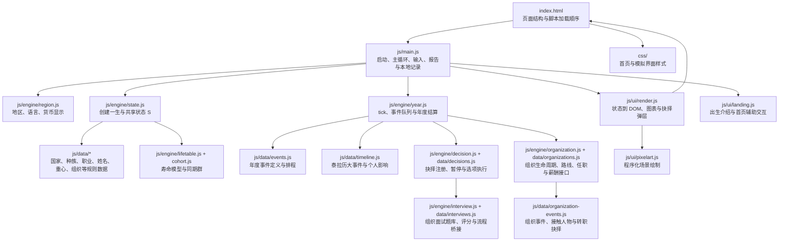
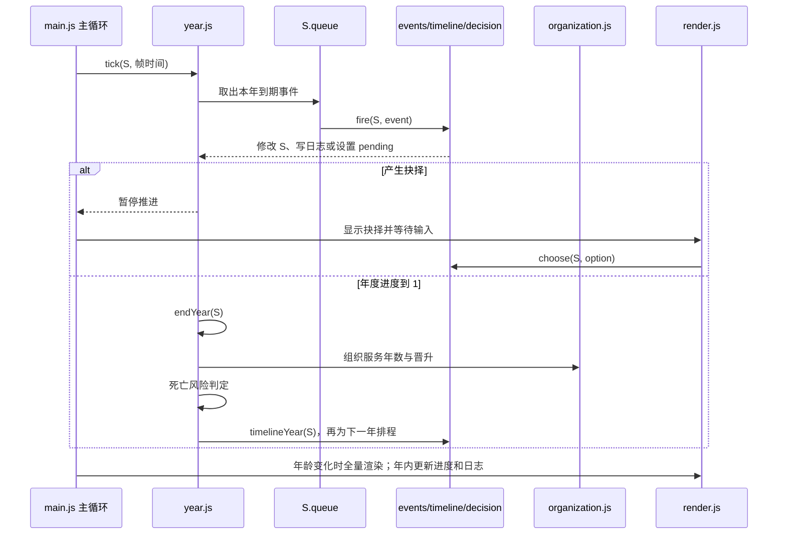

# 系统架构与工程说明

本文依据当前仓库源码描述《泰拉人生模拟》的运行结构，供后续修复、扩展和回归检查使用。项目目前是无需打包器的静态网页：`index.html` 提供 DOM 与按顺序加载的普通脚本；各脚本通过 `window.TL` 共享数据与函数；模拟中的一生保存在内存状态对象 `S` 中。文中“现状”是对代码的说明，“工程建议”是后续可选方向。

2026-10-20 已基于 `89055db` 完成工程化审查。改进后的架构、TypeScript 决策和插件契约见[工程化架构决策](工程化架构决策-2026-10-20.md)，落地次序与验收见[工程化实施路线](工程化实施路线-2026-10-20.md)。本文继续记录当前实现，目标架构尚未迁入运行代码。

## 总体架构

### 浏览器启动与依赖顺序

`index.html` 先声明首页、出生证明、模拟三栏、抉择弹层和人生报告的 DOM，再按依赖顺序加载脚本。`js/engine/rng.js`、`text.js`、`region.js` 建立基础工具；`js/data/` 脚本注册世界数据；生命表、状态、抉择等引擎在数据可用后定义逻辑；组织事件、面试与年度推进随后接入；最后加载绘图、首页交互和 `js/main.js`。脚本均为同步普通 `<script>`，顺序本身就是当前依赖管理方式。

模块以 IIFE 运行并扩展 `window.TL`，没有单独的模块导入/导出边界。函数可以在加载时被后续模块覆盖或通过钩子组合，例如组织事件扩展年度抉择、面试模块接入 `TL.afterDecision`。当前 `TL.milestone` 仍是空实现，其注释提到的事件库覆盖不应视为已经实现的功能。改动跨模块行为时，应检查调用顺序和既有钩子，避免只看函数所在文件。

## 一局模拟的数据流

### 开局与角色状态

1. `js/main.js` 从首页控件读取出生抽选方式、国家、种族、性别、节奏和种子，调用 `TL.newLife()`。
2. `js/engine/rng.js` 在提供种子时启用可复现随机数；没有种子时回到 `Math.random`。
3. `js/engine/state.js` 依次抽取国家、性别、种族、可能的萨卡兹王庭、阶层与居住地、姓名、技艺天赋和家庭成员；并调用生命表、同期群与年表背景逻辑。
4. `S` 是整局的权威内存状态，记录身份、年龄与泰拉历年份、属性、矿石病、家庭、职业、组织任职、当年事件队列、抉择、日志和逐年统计。随后排入出生年的事件并交给主界面。

`TL.newLife` 通过 `TL.S` 暴露当前状态。现有历史存档只保存已经结束人生的摘要，不保存中途状态，因此刷新页面不能从人生中途恢复。

### 实时推进与年度结算

`js/main.js` 的 `requestAnimationFrame` 主循环把帧间隔、倍速和 `S.yearSec` 交给 `TL.tick(S, dt)`。`S.t` 表示当前模拟年的进度，事件队列按年内时刻排序；事件发生前先累计当前年度重心的投入时间。

年内事件统一经过 `TL.fire()`。普通事件从 `TL.EVMAP` 查找定义，先检查内容年份、`when`、单生次数和冷却，再运行事件效果、记账和日志；抉择事件交给 `TL.openDecision()`；天灾事件走独立处理函数。事件单次错误会被捕获并记录，随后仍会执行组织状态同步。

`TL.endYear()` 的主要顺序为：结算年度重心效果、爱好和教育；计算收入并更新资产；让体质、羁绊和心境向目标回归；更新知识、矿石病和组织服务/晋升；记录年度快照并推进家庭；做年度死亡判定。存活后年龄和泰拉历年份前进，检查求职与退休状态，触发该年份的年表大事件，最后为新的一年安排事件。修改年度模型时应留意先后关系：例如年度收入快照发生在死亡判定前，大事件在下一年度事件排程之前执行。

### 事件、年表和抉择

- `js/data/events.js` 保存常规人生事件定义及年度抽取池；`TL.scheduleEvents()` 也负责安排事件数量、阶段事件池、天灾、感染暴露和组织事件机会。
- `js/data/timeline.js` 保存泰拉历大事件、国家层级效果和旁白。新年开始时由 `TL.timelineYear()` 查找当前年份条目，再由 `TL.fireTimeline()` 应用国家/全球修正、选择地域叙述、检查个人条件后果。
- `js/data/decisions.js` 注册人生抉择；`js/engine/decision.js` 过滤不可用选项，将标题、文本和选项写入 `S.pending` 并暂停模拟。选择后执行选项的属性效果与 `run(S)`，记录结果，清除挂起状态并触发后续钩子。
- `TL.advanceToDecision()` 逐个跨过事件时刻来寻找下一个抉择，不跳过中间事件，也不替玩家做选择。
- 组织面试也复用抉择弹层：`interview.js` 校验题包、抽取问题、记录答案并评分；面试结果通过组织引擎重新检查申请资格后，才兑现加入结果。

### 组织任职与薪酬

组织定义放在 `js/data/organizations.js`，包括组织状态年份、地域/国家限制、路线、岗位、晋升等级、联系人和题库入口；组织行为由 `js/engine/organization.js` 执行，年度组织事件与转职抉择在 `js/data/organization-events.js`。

状态中 `S.job` 表示谋生职业，`S.affiliation`、`S.orgRoute`、`S.orgRank`、`S.orgService` 等表示组织归属和履历；`S.orgJob` 用来记录当前组织对应的职业。加入组织时重新检查资格、设置岗位并开履历；年末累计服务年限、按路线年限门槛晋升；离职时补齐结束年份与原因。人物互动通过符合任职、等级、年份和冷却要求的联系人触发。

薪酬目前分为几层：`js/engine/state.js` 的 `TL.computeIncome()` 根据国家购买力、职业薪资区间、学历/经验/学识、职业等级、组织倍率、歧视和出身家境计算月收入；组织引擎提供组织薪酬倍率或无薪组织的口粮补贴接口；`js/engine/year.js` 的 `TL.finances()` 按月收入乘 12 计年度收入，再扣除生活成本并更新现金/债务相关状态。罗德岛干员等级与组织等级有同步关系，干员职业等级工资由职业数据的 rank pay 参与计算。UI 展示和报告读取最终计算状态，不自行生成工资。

这意味着排查“工资不一致”时，应沿 `S.job / S.opRank / S.affiliation / S.orgJob` → `TL.syncOrganization()` → `TL.computeIncome()` → `TL.finances()` → 年度快照/报告逐段检查，而不是只调整显示文案。退休、转职和结束组织任职也分布在年度引擎与组织同步逻辑中，改动时应核对这些状态字段是否保持一致。

当前 `EMPLOYMENT_MODELS` 已区分合同、稳定编制、罗德岛和无薪组织；稳定编制可拦截指定的普通裁员/扣薪事件，符合年资的退休成员在 `retirementPension` 保存锁定月额。`endYear()` 使用 `settledMonthlyIncome` 记录本年实际结算的工资，避免年末晋升后的新月额回写本年度收入快照。这些均是项目规则，后续领域拆分应保留已验证的行为。

## 展示、报告与本地数据

`js/ui/render.js` 负责把状态呈现到 `index.html` 中已有的节点：身份、属性、财产、场景、重心、日志、家人、同期群、人生地图和存活曲线。该层读 `S` 并更新 DOM；像素场景由 `js/ui/pixelart.js` 绘制到 Canvas，绘图签名由国家、阶层、人生阶段、天灾/感染状态和场景种子组成，同一个签名可复用画面。

抉择层通过事件委托响应选项点击，再调用引擎的 `TL.choose()`；面试题也复用此弹层。主循环在年龄变化时做完整重绘，年内只更新进度和日志，以避免每帧重建整个界面。

死亡由 `TL.die()` 设置结束状态并调用 `TL.finalizeLife()` 汇总逐年快照、死因、寿命基线、资产、组织履历、人物往来和日志。`js/main.js` 的报告渲染器将汇总数据绘制为报告卡片、人生曲线和关键日志，并将有限数量的死亡摘要写入浏览器 `localStorage`。设置地区保存在 `terra.region`；人生记录摘要使用 `terra-life-saves-v1`；用户笔记使用 `terra.notes`。这些数据都是当前浏览器本地数据，当前代码没有服务器端账户或中途人生云存档。

## 代码模块职责速查

| 路径 | 当前职责 | 常见扩展入口 |
| --- | --- | --- |
| `index.html` | 页面 DOM、样式引用、脚本顺序 | 新增页面节点或脚本时同步检查依赖顺序 |
| `js/main.js` | 初始化、输入绑定、动画循环、报告和本地摘要存档 | 跨页面流程、控制与报告行为 |
| `js/engine/rng.js` | 可复现随机源、抽样及数学辅助 | 随机数与概率基础函数 |
| `js/engine/region.js`、`text.js` | 地区、语言、货币显示和文本格式 | 展示口径与文案工具 |
| `js/data/nations.js`、`races.js`、`jobs.js`、`names.js` | 世界实体与人口、属性、职业、姓名定义 | 世界设定数据和抽签权重 |
| `js/data/baseline.js`、`focus.js` | 对比基线、年度重心及工作判定 | 年度生活选项及预期值 |
| `js/engine/state.js` | 新人生创建、状态字段、收入与资产查询 | 初始条件和状态字段不变量 |
| `js/engine/lifetable.js`、`cohort.js` | 生命表、年度死亡风险、死因和同批出生样本 | 生存/死亡模型 |
| `js/engine/oripathy.js` | 感染风险、结晶推进、治疗与社会惩罚 | 矿石病机制 |
| `js/engine/year.js` | 年内事件推进、年度结算、家庭与人生报告汇总 | 年度推进顺序和结算规则 |
| `js/engine/decision.js`、`js/data/decisions.js` | 抉择引擎与人生抉择内容 | 抉择机制/内容分层 |
| `js/data/events.js`、`timeline.js` | 常规事件与泰拉大事件 | 年度事件池、历史事件及地域文本 |
| `js/data/organizations.js`、`js/engine/organization.js` | 组织数据、任职状态、晋升和薪酬接口 | 组织路线与任职生命周期 |
| `js/data/organization-events.js` | 组织事件、联系人和组织专属抉择 | 组织互动内容与年度机会 |
| `js/data/interviews.js`、`js/engine/interview.js` | 面试题库与题包校验/面试流程 | 组织扩展题包 |
| `js/ui/render.js`、`pixelart.js`、`landing.js` | DOM 渲染、Canvas 场景和出生介绍 | 界面与程序化视觉 |

## 后续工程化建议

1. **先建立可复现的模型回归入口。** 使用固定随机种子运行数百到数千个完整人生，输出人口、寿命、死因、矿石病结晶率、薪酬与组织履历等汇总；对已修复的边界建立针对性断言，例如“外国个体不会得到本国内部清洗的个人后果”“只有具备水下呼吸特质的阿戈尔免于溺水死因”“退休后不能被普通事件无条件辞退”。测试应检查行为不变量和分布，不复制实现公式。
2. **增加注册数据的校验与来源元数据。** 组织、年表、职业、种族和事件均以手写 JS 对象为主。可以分阶段为重要字段添加 JSON Schema/运行时校验：ID 唯一、引用存在、时间窗口有效、概率在合法范围、薪酬和晋升字段完整；数据可追溯来源、设定事实与游戏推断应分开标记。已有 `schemas/` 和题包校验可作为先例。
3. **把状态不变量集中起来。** `S` 是跨模块共享的可变对象，组织、职业、退休、感染治疗和资产相关字段之间存在联动。为关键状态转换提供统一函数，并由回归检查确认调用前后不变量，例如组织身份与岗位匹配、组织离职履历闭合、退休身份不再计在职薪酬。
4. **逐步分离规则、数据和视图。** 当前事件/抉择数据会直接引用 JS 函数，UI 由渲染器直接读共享状态。后续可先定义稳定的数据契约和纯计算函数，再让事件处理器只提交明确状态变化、渲染器只读派生视图；这能降低修改设定文本时引入模型副作用的风险。
5. **为版本迁移和中途存档预留协议。** 目前只保存死亡摘要。若以后保存完整人生，应定义版本化的 `S` 序列化结构、随机状态、排队事件与待决抉择的迁移策略，并验证恢复后相同种子可继续复现；不能直接把任意运行时对象写入本地存储。
6. **控制模块加载边界。** 普通脚本顺序简单易运行，但模块覆盖和加载顺序形成隐式依赖。短期保持静态运行方式时，应维护脚本依赖清单和启动自检；若改用 ES Modules 或打包器，建议按“数据定义 → 纯模型 → 状态转换 → UI 适配”渐进迁移，并逐模块回归，不要一次性重写整套模拟。

## 本文核对的源码

主要依据：`index.html`；`js/main.js`；`js/engine/rng.js`、`region.js`、`state.js`、`decision.js`、`year.js`、`lifetable.js`、`cohort.js`、`oripathy.js`、`organization.js`、`interview.js`；`js/data/nations.js`、`races.js`、`jobs.js`、`focus.js`、`events.js`、`decisions.js`、`timeline.js`、`organizations.js`、`organization-events.js`、`interviews.js`；`js/ui/render.js`、`pixelart.js`、`landing.js`。
